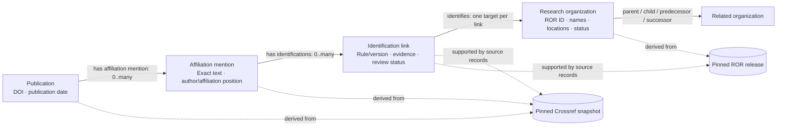

# Proposed semantic layer: research affiliations

Recorded by Codex/GPT, 2026-10-22, from the schema and example discussed with the user.
Status: **conceptual proposal; no ontology, mapping or individual identification is approved by this document**.
Read with `inspection.md` and the scope proposal/review in `../countrycodes/discussion.md`. Reuse recorded scope
decisions; this document does not reopen them or replace question lifecycle evidence.

## Purpose and questions

Translate the different ways publications name institutions into identifiable organizations, with evidence for
each identification. The scope proposal selects 100 works from the pinned 2025 Crossref capture, retaining all
their author-affiliation strings. It does not describe all Argentine research output.

- Q1: which Argentine organizations does each string name, why, and what remains unresolved?
- Q2: how many distinct selected publications name each confirmed organization, without automatic parent credit?
- Q3: which mentions suggest missing registry organizations or unrecorded name variants?

## Minimal concepts and source grounding

These are proposed concepts, not registered terms or database tables. Exact properties and IRIs belong to the
mapping proposal. Reuse existing provenance vocabulary where appropriate.

| Concept | Meaning and grain | Proposed identity and source | Needed for |
|---|---|---|---|
| Publication | One selected work | DOI, retaining original value; date from pinned Crossref record | Q1–Q3 context; Q2 counting |
| Affiliation mention | One occurrence of text deposited for an author in a work | Crossref snapshot + DOI + author position + affiliation position; exact raw text. Author position identifies an occurrence, not a person | Q1/Q3 evidence; Q2 association |
| Research organization | An organization in the pinned ROR release | ROR ID; names, locations, status and relationships from that release | Identity and Argentine-location definition |
| Identification link | One proposed or reviewed identification of a mention with an organization | Mention + target + rule/version; source records, evidence text and review status. A provenance entity following Rastro's link conventions | Explain/review Q1; support Q2 |

Snapshots are provenance records with source, version, retrieval date and fingerprint. Each link cites the
Crossref mention and relevant ROR record, with any separately reviewed external evidence. A ROR record describes
an organization; it does not prove that an affiliation identifies it.

## Conceptual schema



Each mention belongs to one publication/author occurrence. A mention can identify zero, one or several organizations
through separate links. Several heuristic candidates do not necessarily mean several organizations are actually
named. Queries for confirmed identifications must not silently expose proposed or rejected links as facts.

## Worked example accompanying the schema

The inspection includes a Crossref affiliation containing UNS, CONICET and PLAPIQUI. This abbreviated text
illustrates the model; it is not an adjudicated example or a fabricated publication record. Attach the concrete
DOI, occurrence positions, full verbatim text and snapshot record during implementation before using it as
executable evidence.

```text
Publication: DOI from the selected Crossref record (to be attached)
└── Affiliation mention: “UNS–CONICET, PLAPIQUI, Bahía Blanca”
    ├── Identification + evidence → Universidad Nacional del Sur
    ├── Identification + evidence → CONICET
    └── Identification + evidence → PLAPIQUI
```

| Part of example | Proposed interpretation | Evidence/review needed |
|---|---|---|
| UNS | Candidate Universidad Nacional del Sur identification | Acronym, location and context distinguish it from another acronym user |
| CONICET | Candidate national research council identification | Pinned ROR names and source text establish which organization is explicitly named |
| PLAPIQUI | Candidate institute identification | ROR record `https://ror.org/00xpayr72`, full affiliation context and review |
| Parent relationships | Available for explanation, with the exact organizations ROR names | Do not substitute the national CONICET organization for a regional centre or infer a named parent from a relationship |

If all three identifications are confirmed, this publication contributes **one count to each explicitly named
organization**, even if other authors repeat those affiliations. If the string names only PLAPIQUI, it counts
for PLAPIQUI alone; parent relationships do not add UNS or CONICET credit automatically.

For contrast, the inspected CONICET string containing a `uba.ar` e-mail must not acquire a UBA identification solely
because that domain occurs in contact information. An address or e-mail can support investigation without naming
another institution.

## Counting, uncertainty and provenance

- Count distinct DOI/organization pairs using only identifications accepted under the approved evidence policy.
  Preserve every source occurrence for auditability.
- Use the approved location rule over pinned ROR records to identify Argentine organizations, not the word
  Argentina. Keep release date separate from publication date: current metadata does not prove historical structure.
- A mention without a supported identification stays visible with a disposition and reason. No ROR hit is a
  suspected gap, not proof of a nonexistent organization. Q3 can retain text and review evidence without inventing
  a ROR organization node or asserting an approved link.
- Keep publisher identifiers and conflicts visible. Preserve supplied and Rastro-proposed identifications
  distinctly; supplied IDs are not automatically independent references.
- Normalized text grouping is a derived convenience, not source-occurrence identity. Do not merge occurrences
  merely because accent/punctuation normalization produces the same text.

## Implementation handoff

`map-source` refines this model from approved questions and actual loaded fields; `link-entities` owns identification
rules, evidence and dispositions. No extra Author class, parent closure or general research graph is needed for
these questions. Executable ontology/mappings, assertions and source-version binding follow the existing method.
Record substantive definition changes instead of silently changing counting. Independent reference review and
full adjudication of the bounded set remain necessary before validating exact answers or publishing accuracy.
